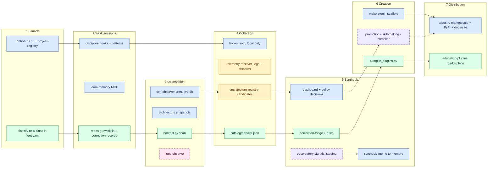
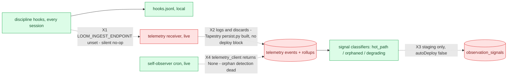
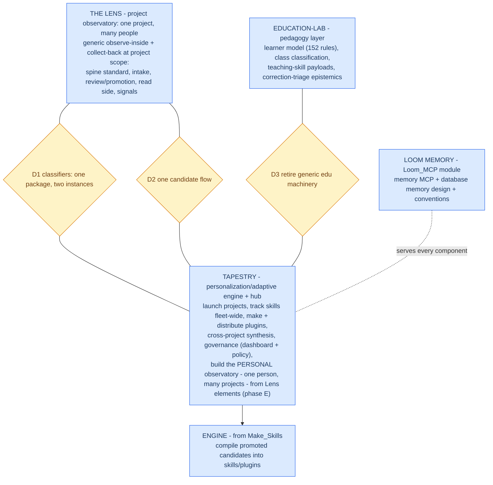

# Task-division study: who does what across the fleet

**Status:** Findings complete; groupings proposed; decisions listed for the operator
**Date:** 2026-10-21
**Method:** three read-only task inventories (tapestry, education-lab, the-loom + Make_Skills) by infrastructure-mapping agents with file:line evidence, plus contributions from the live lens-core and education-lab sessions. Detail files: `task-inventory-{tapestry,education-lab,the-loom}.md` in the 2026-10-21 session scratchpad; durable records in loom memory (`five-component-clarifications-round3-2026-10-21`, `handoff-tapestry-education-lab-task-inventory-2026-10-21`, `correction-tapestry-services-migrated-not-stubs-2026-10-21`).

The operator's component frame this study serves: Loom memory = the MCP and the database memory design. The personal observer's only existing piece is the self-observer cron and its script. Tapestry = the personalization/adaptive engine so far. Open question: Tapestry vs education-lab, who does what.

## 1. What each repo actually does

### Tapestry (live monorepo)

| Task | Trigger | Status |
|---|---|---|
| Launch projects: `tapestry init/onboard` registers with project-registry, writes .env/.mcp.json/.project-intelligence/CLAUDE.md, enables plugins | CLI | working (`packages/cli/tapestry_cli/init.py`, `onboard.py`) |
| loom-memory MCP (memory_read/write/recall/...) over pgvector Postgres | HTTP, deployed | live (`services/agent-context/main.py`) |
| project-registry (projects/repos/machines CRUD) | HTTP, deployed | live (`services/project-registry/main.py`) |
| Discipline hooks: snapshots+diffs at SessionStart, PROBE reminders, Stop audits, session reports autocommitted | Claude Code hooks | working (`integrations/claude-code/tapestry-discipline/scripts/`) |
| Path A observer: Skill-call counts + upskilling report → candidate POST | inside Stop hook | working (`observer.py`) |
| Hook observability: hooks.jsonl + OTLP + POST to telemetry-ingestion | every hook | working but ingest endpoint unset (see §4) |
| self-observer: 6-hourly GitHub scan of every registered repo's skills/agents → drift candidates + synthesis memo to memory | Render cron | **LIVE** (`tapestry-self-observer-cron`, infra/deploy/render.yaml:160-163) |
| project-observatory: hot_path/orphaned/degrading classifiers over telemetry | cron + HTTP | built + tested, **staging only** (`services/project-observatory/`) |
| telemetry-ingestion: persistence + read API (0-vs-None contract) | HTTP | built, **not deployed from Tapestry** |
| architecture-registry, policy: candidate store + auto-dispatch; decision audit | HTTP | live under legacy loom-* names |
| skill-making bridge + engine/skill-compiler | HTTP / library | code complete, **not deployed**; `engine/` otherwise empty slots |
| make-plugin scaffold; marketplace `tapestry`; PyPI CLI; docs-site + docs-mcp | CLI / installs / Vercel | working |

Correction recorded: the prior belief that self-observer, telemetry-ingestion, policy, and architecture-registry exist only as working code in the-loom with README stubs here is stale. They migrated; CLAUDE.md's CORE DIRECTIVE 2 sentence needs updating.

### education-lab

Run order (its own module map): harvest → classify → rules → compile → publish → distribute, with correct + observe as the feedback leg.

| Task | Trigger | Status |
|---|---|---|
| harvest.py: registry-driven scan of every class repo's `skills/*/SKILL.md` + `.project-intelligence` records → `catalog/harvest.json` + report | CLI; daily Action blocked on `HARVEST_TOKEN` | working code |
| classify: `catalog/fleet.yaml` (class kinds, subject tags, needs) | manual + discovery agents | working data |
| rules: `rules/learning-principles.yaml`, 152 tagged rules on how the operator learns STEM | manual PRs + correction amendments | canonical data |
| compile_plugins.py: rules → `../education-plugins/plugins/learning-core/` (+ drift check) | CLI | working; only the rules file is compiled — every SKILL.md is edited directly in education-plugins |
| publish + distribute: marketplace `education-lab` (learning-core, stem-walkthroughs, discovery-apps) → per-repo settings.json | manual, human-merged | 3 plugins shipped; distribution 7/9 repos |
| correction-triage: correction records → rule/skill PRs the operator merges (two-independent-classes convergence rule) | skill invocation | first triage logged |

Its only data path back from projects is reading git; the learning-core hook inside projects is a soft page linter and sends nothing back. Its charter already plans to hand fleet-watching to the Tapestry observatory once live.

**Specific purpose** (per its own session + the scan): the learner model and pedagogy — learner profile, tagged learning rules, classifying classes by how they teach and test, teaching-skill payloads, judging corrections against learning rules. **Everything else is generic project-intelligence machinery with no education in it** (scanner, compile/sync, scheduled runner, correction collection + convergence rule, docs machinery). The duplication was deliberate (its ADR 0001) so class and platform tooling could version independently.

### the-loom (retired source) + Make_Skills

| Piece | Reality |
|---|---|
| telemetry receiver `POST /skill-used` | deployed and live, but **log-emission only — it discards the data** (`main.py:67-70`) |
| architecture-registry, policy | live from the-loom under loom-* names; Tapestry copies are the newer code, repoint gated |
| project-observatory | the-loom copy is a 24-line /health stub; the real classifiers were built fresh in Tapestry |
| self-observer | the-loom render.yaml:292-302 still carries a cron block — potential double-blueprint with the live Tapestry cron; runtime state unverified |
| Make_Skills engine | owns skill compile: promotion → bridge receiver → SKILL.md persisted → compiled StructuredTool → RegistrationAck. This loop is the one path live end-to-end for kind=skill |

### The Lens (intended division, not yet observed behavior)

Per the approved `observatories.md` and spine: lens-core = standard (candidates → decisions → verified + lineage) + module index + launcher; lens-ingest = intake; lens-review = promotion; lens-serve = read; lens-observe = signals. The sibling repos' triggers are largely not implemented yet; treat this column as charter, not code.

## 2. The flow of work today

Reading it by color: blue (Tapestry, live), green (education-lab), amber (legacy the-loom deployments), dashed purple (built but not deployed), dashed pink (Lens, charter only). The green lane is a complete, working, human-gated copy of the loop the blue lane runs generally — which is the overlap in one picture.

## 3. Duplications the groupings must resolve

1. **Three repo scanners:** self-observer cron, harvest.py, architecture_snapshot (the canonical extractor). All read static file structure from outside; none observes behavior.
2. **Three candidate→decision flows:** architecture-registry + policy (live), correction-triage + operator merge (working), the Lens spine candidates → decisions → verified (approved standard).
3. **Three plugin production lines:** tapestry marketplace + make-plugin (+ undeployed compiler path), education-plugins compile→publish→distribute, Make_Skills engine compile (live for kind=skill).
4. **Two signal engines on two different layers:** the Lens watches one project for many people; Tapestry's observer watches many projects of one person. Tapestry's `services/project-observatory` reads one person's telemetry across the whole fleet — the personal layer's engine wearing the project layer's name — while lens-observe is the project layer's engine (charter only). The classifiers themselves are scale-neutral pure functions, so the real conflicts are the name, the vocabulary, and the packaging, not which engine survives (see D1).

## 4. The four broken wires (all wiring, not code)

Consequence: the only live observer (the cron) is a documentation linter on a schedule — it reads file text, never sessions, tool calls, friction, or usage. That is the mechanism behind "the cron hasn't been enough." Each wire has working code on both ends; closing all four turns the existing pipeline on without building anything new.

## 5. Proposed grouping

The organizing principle (the operator, 2026-10-21): one supervisor has one agent overseeing one program with many people in it; each of those people has one agent helping with their many tasks. The program agent watches the telemetry of the many people at the program's shared surface — that stream is its own behavior and feeds the program's shared knowledge. The personal agent watches the telemetry of one individual across all their projects — its own behavior, feeding the person's own shared knowledge. The same agent shape at two levels, each owning its telemetry and its knowledge store, meeting only at shared interfaces. The shape is the same because both oversee knowledge flow with the same decomposition (the Surveyor method); only two parameters vary — the telemetry (which layer feeds it) and the domain (what the knowledge is about). This is why the same machinery (classifiers, spine, review, memory) rightly appears at both levels: package once, instantiate per layer and domain. education-lab is the personal shape with the learning domain plugged in.

Task assignments under this grouping:

| Component | Keeps / takes | Gives up |
|---|---|---|
| Loom_MCP | memory MCP, database memory design, conventions doc, tenant key ops (candidate) | — |
| The Lens | generic in-project observation + collection at project scope; the spine as the one candidates→decisions→verified standard | — (gains implementation, see D1/D2) |
| Tapestry | launch (CLI + registry), fleet skill tracking, plugin production + marketplace + PyPI + docs distribution, cross-project synthesis + governance, the personal observatory (self-observer cron as its seed + the reusable pieces: pure classifiers, persist substrate, 0-vs-None contract, hook collection layer, memo-to-memory pattern) | the project-observatory NAME (it belongs to the Lens layer); Tapestry's running instance re-scopes as the personal observer |
| education-lab | the pedagogy layer only | harvest scanner, scheduled runner, compile/sync + distribute mechanics, correction-record collection — each retires into its platform equivalent as the wires close (staged, per-piece, operator-scoped; its ADR 0001 fork ends when the platform side is actually live) |
| Engine | skill compile (the one live end-to-end creation loop for kind=skill) | — |

## 6. Decisions for the operator

1. **D1 — one classifier package, two observatory instances.** The two layers are different jobs: the Lens watches one project for many people; the personal observer watches many projects of one person. Tapestry's built classifiers are scale-neutral pure functions, and its telemetry pipeline reads one person's sessions across the whole fleet — so the running code is the PERSONAL layer's engine wearing the project layer's name. Proposed resolution: package the classifiers once (a published package, per the reuse rule), run one instance per layer over its own data, settle one shared vocabulary, and give the project-observatory name to the Lens while Tapestry's instance becomes the personal observer. To confirm: the vocabulary, the package's home, and the rename.
2. **D2 — one candidate→decision flow.** architecture-registry + policy (live, auto-dispatch, audit) vs the Lens spine (approved standard). Same options shape as D1.
3. **D3 — education-lab's generic machinery retires into the platform** on a staged schedule as each wire closes: harvest's scanner folds into the observer once the observer sees usage (X4 fixed); compile/publish/distribute folds into the marketplace machinery; correction-record collection folds into .project-intelligence + promotion. Education-lab keeps pedagogy. (Both live sessions independently proposed this split; it is consistent with education-lab's own charter.)
4. **The four wires (§4)** are the cheapest high-value work in the fleet: set the ingest endpoint, deploy Tapestry telemetry persistence, promote the observatory off staging, swap the self-observer's None stub for the built read API. Order and ownership are the operator's call; D1 affects where the deployed pieces ultimately live, but the wiring itself is the same either way.
5. **Still open from the roadmap:** the Lens-vs-interface naming conflict; tenancy's home (access+tenancy repo vs Loom_MCP vs project-registry); names for the two proposed Lens repos; rotating the leaked PROVES service_role key (Phase 0, operator-owned).

## Sources

- Agent inventories (2026-10-21 session scratchpad): task-inventory-tapestry.md, task-inventory-education-lab.md, task-inventory-the-loom.md
- loom memory: five-component-clarifications-round3-2026-10-21; handoff-tapestry-education-lab-task-inventory-2026-10-21; correction-tapestry-services-migrated-not-stubs-2026-10-21; for-tapestry-observatories-approved-2026-10-21
- lens-core: docs/architecture/observatories.md (approved 2026-10-21); docs/plans/2026-10-21-roadmap-method-proposal.md
- tapestry: docs/proposals/2026-10-20-loom-mcp-module.md (its "Lens becomes the interface" line is superseded pending the naming decision)
